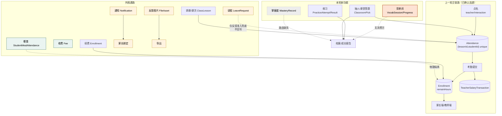

# 牧哲学堂 · 数据通路与 UI 合规核查报告

- 核查日期：2026-11-08（第二轮，延续 `牧哲学堂数据链路连通性核查_2026-11-08.md`）
- 仓库：`D:\01muzhexuetang\muzhexuetang\coding\edu-manage`
- 性质：**只读审计**。未改源码、未改数据库、未跑 migrate、未重启 dev 服务。
- 本轮范围：面 A（12 条数据通路：新功能 + 外围通路）与面 B（UI 合规 B1–B7）
- 上一轮已确认、本轮**直接引用不重验**的事实：点名与考勤同表同键 `attendance_lesson_student_unique`；`LEAVE` 一律扣整节、`ABSENT` 按计费模式；余额双口径 136/191 不一致；撤销反馈不冲销 5090 条 `FEEDBACK_BONUS`

---

## 〇、三句话看结论

1. **12 条通路里：连通 3 条（续费、收费、餐食），部分连通 8 条，孤岛 1 条（背单词）。**
2. **最该先处理的三处不是视觉，而是口径**：请假单与考勤两套记录几乎完全脱节（925 条请假考勤中 921 条无单据）；掌握度链路实际没通电（`/api/teacher/mastery` 路由不存在，前端报错被吞）；导出用 `Student` 快照且不过滤软删/退班（194 行含 37 个页面不可见学员）。
3. **UI 侧没有红线级违规**（SVIP 墨绿渐变、金边、等级标签色值都在，毛玻璃零滥用、emoji 零使用）；问题集中在**令牌从未收敛**：圆角 12 套值、规范区间只占 13%，`box-shadow` 82% 裸写。

---

## 一、数据通路总图

节点表：

| 节点 | 写方 | 读方 | 状态 |
|------|------|------|------|
| 背单词 | `api/parent/vocab/session/route.ts:92-142` | 仅 `/parent/vocab` 本页 | **孤岛** |
| 抽人/答题 | `api/teacher/interaction/pick/route.ts:105-114` | 家长互动页、教师页 | 部分连通 |
| 练习 | `api/parent/practice-results/route.ts:261,271-288` | 家长回看、管理端统计 | 部分连通 |
| 掌握度 | **无写入口** | `students/[id]/context/route.ts:34-38` | **断（路由缺失）** |
| 请假 | `api/leave-requests/[id]/route.ts:45-53` | 请假统计 / 反馈准入 | 部分连通 |
| 排课→考勤 | `lib/data-correction/trash.ts:187-191` | 考勤表 | 部分连通 |
| 续费 | `class-groups/[id]/enrollments/route.ts:191,195,203` | `Enrollment` + 快照 | 连通 |
| 收费 | `api/fees/route.ts:234-262` | 无（定向隔离） | 连通·隔离 |
| 餐食 | `lib/meal-attendance-sync.ts:53-71` | 餐食表 | 连通·隔离 |
| 通知 | `lib/notification*` | 家长通知中心 | 部分连通 |
| 家长绑定 | `lib/parent-children*` | 各家长路由 | 部分连通 |
| 反馈图片 | 上传路由 + `lib/classroom-feedback/access.ts` | 家长/教师 | 部分连通 |
| 导出 | `api/settings/export/students/route.ts:19-21,30` | 运营 | 部分连通 |

---

## 二、通路逐条结论

| # | 通路 | 结论 | 风险 | 一句话证据 |
|---|------|------|------|-----------|
| 1 | 背单词 VocabProgress/Session | **孤岛** | 中 | 唯一读方 `api/parent/vocab/route.ts:40-42`（本页自回显）；教师端/周报/成长报告零引用 |
| 2 | 课堂答题与抽人 | 部分连通 | 中 | `pick/route.ts:105-114` 只写 ClassroomPick，NEEDS_WORK 不沉淀 WeaknessRecord |
| 3 | 练习 practice | 部分连通 | **高** | `practice-results/route.ts:261,271-288` 落库闭环；但掌握度分支断（见下） |
| 4 | 请假 leave | 部分连通 | **高** | 审批只改 LeaveRequest（`leave-requests/[id]/route.ts:45-53`），**不回写考勤** |
| 5 | 排课→课次→考勤 | 部分连通 | 中 | `trash.ts:187-191` 软删课次不处理考勤，残留 39 条 |
| 6 | 报名与续费 | 连通 | 低 | `enrollments/route.ts:191,195` 同事务 total=remain=hours，`:203` 同步快照 |
| 7 | 收费 fees | 连通·定向隔离 | 低 | `fees/route.ts:234-262` 事务内仅 fee+activityLog，6 个写点零耦合课时/工资 |
| 8 | 餐食 meals | 连通·隔离成立 | 低 | `meal-attendance-sync.ts:53-71` 只写 StudentMealAttendance，不进扣减循环 |
| 9 | 通知 notifications | 部分连通 | 中 | 死链 `/leave-requests`（无 page.tsx，库内 6 行） |
| 10 | 家长绑定可见范围 | 部分连通 | 中 | 5 套并行判据；解绑后通知仍按 userId 可见（`parent/notifications/page.tsx:20-23`） |
| 11 | 反馈图片资产 | 部分连通 | **高** | 撤销后家长拒绝、**原上传教师仍放行**（`access.ts:703-707`）；OSS 未签名直链 |
| 12 | 导出 export | 部分连通 | **高** | `export/students/route.ts:19-21` 只过滤 division，`:30` 取 Student 快照 |

### 通路 1 · 背单词 → **孤岛**

- 写方：`src/app/api/parent/vocab/session/route.ts:92-142`（写 `VocabSession` + `VocabProgress`，含状态机）
- 读方：**唯一** `src/app/api/parent/vocab/route.ts:40-42,71-76` —— 就是背单词页自己回显
- 转换层：`src/lib/vocab-bank.ts` 只是题库/词表，**没有聚合层**
- 口径分裂：无「连续天数」字段，也没有"本周新增 xx 词"这类可直接进周报的派生值
- 判定：**孤岛**（有写入、无下游）
- 失效现象：家长在成长报告/周报/学情档案里看不到孩子背了多少词；教师端完全不可见（老师无法据此布置复习）；库内仅 1 名测试学生（16 条进度 + 2 条会话），说明**功能上线了但还没有真实使用与消费方**
- 与规范的一致性：这个模块恰恰是 `project-baseline.md:56` 里点名的"已落地参考实现"（P10/P14/P23/P25 都有对应），**动画做完了、数据没接出去** —— 典型的"设计了但没接"

### 通路 2 · 课堂答题与抽人 → 部分连通

| 要素 | 事实 |
|------|------|
| 写方 | `pick/route.ts:105-114`：`ClassroomPick`（lessonId/studentId/teacherId/round/source/questionLabel/result/comment） |
| 读方 | 家长端互动接口（`summarizeParticipation`）、教师互动页回显 |
| 转换层 | `classroom-interaction.ts` 纯函数（权重、轮次、参与度汇总） |
| 口径分裂 | `ClassroomPick` 与 `ClassroomFeedback` **无持久外键**，只在查询时按 `lessonId+studentId` 拼合 |
| 判定 | 部分连通 |
| 失效现象 | 家长能看到"这学期被抽中 N 次、答对 M 次"，但**看不到薄弱知识点**；老师看不到跨课次的参与度趋势（没有聚合表）；答 `NEEDS_WORK` 的题不会沉淀成薄弱点 |

### 通路 3 · 练习 practice → 部分连通（掌握度分支是断的）

**练习落库本身是健康的**（这部分要给正面证据）：
- `src/app/api/parent/practice-results/route.ts:261,271-288`：`practiceAttempt.createMany`（逐题留档）+ `practiceResult.upsert`（按学生×题组汇总）
- 幂等靠 `submissionId`；事务用 `Serializable` + P2034 重试；题目快照不可变
- 读方：家长自回看 + 管理端统计

**但掌握度链路没通电**：
- `MasteryRecord` 表存在、教师录入面板存在（`src/app/teacher/students/[id]/client.tsx:486` POST `/api/teacher/mastery`）
- **该路由全仓不存在**（递归过滤 `app/**/route.ts` 中文件名含 `mastery` 的结果为空；`masteryRecord.create/upsert/update` Grep 命中 0）
- 前端调用被 `.catch(() => {})` 吞掉 → **老师点保存、没有任何反应、也没有报错**
- 唯一读方 `students/[id]/context/route.ts:34-38` 读的是一张永远为空的表

**失效现象**：老师以为录入了掌握度，实际什么都没存；作业/练习的错题不回流薄弱点，学情档案永远是空的"掌握度"区块。

### 通路 4 · 请假 leave → 部分连通（本轮最严重的口径分裂）

- 写方（请假单）：`src/app/api/leave-requests/[id]/route.ts:45-53` —— 事务内**只有** `tx.leaveRequest.updateMany`，全段没有 `tx.attendance.*`
- 写方（考勤）：考勤提交/管理更正里的 `status='LEAVE'`（老师手工标记）
- 唯一跨表点：`src/lib/classroom-feedback/lesson-eligibility.ts:68-74`（考勤无记录时，用 pending/approved 请假单**拦截反馈准入**）—— **只用于准入判断，不回写考勤**
- 判定：部分连通（两套记录靠人手工对齐）

**库内实测（这组数字最能说明问题）**

| 检查 | 结果 |
|------|------|
| 已批准请假单 | **2** 张（均未挂 lessonId，按日期匹配） |
| 其中考勤仍为 `PRESENT` | **12 行（75%）**；**2/2** 张单据都含 PRESENT 行 |
| 样本 | 韩\*\* 2026-08-03 批准请假 → 当天 8 节课考勤**全部 PRESENT** |
| `status='LEAVE'` 考勤行 | **925** 行 |
| 其中找不到任何请假单 | **921** 行（**99.57%**） |
| 请假扣掉的课时 | **922 行 / 合计 646.6 课时**（0.7h×918 + 1.0h×4） |

**失效现象**（家长视角）：请假已批准 → 老师考勤记到课 → **照样扣课时**（0.7h），家长端还显示"已出勤"。请假统计（读请假单）与考勤统计（读 Attendance）永远对不上，且没有对账任务。

### 通路 5 · 排课/课次 → 考勤 → 部分连通

- 写方：`src/lib/data-correction/trash.ts:187-191` —— 课次软删事务只处理试卷/反馈/动态/资料，**没有任何 attendance 写入**
- 判定：部分连通（软删课次后考勤**原地残留**）
- 库内实测：**39** 条考勤挂在已软删课次；**1181** 条挂在 `WITHDRAWN` 报名（合计 **838.4 课时**），其中课次未软删的 **1142 条 / 799.4h（96.7%）**
- 口径分裂：更正课时读的是考勤上的**历史 `enrollmentId` 快照**，换班/换报名后可能报 `ENROLLMENT_NOT_FOUND`
- 已确认正常：换老师不会双计 —— `lessonPayKey = lessonId` 唯一键 + `FOR UPDATE` 行锁（一课次一条课时费）。**但反过来说：原老师已入账后再换老师，新老师拿不到这笔课时费**，这是需要你拍板的业务口径
- 失效现象：删了一节课，考勤行还在（报表里仍有这门课出勤）；退班学员的历史考勤仍带课时扣减

### 通路 6 · 报名与续费 → **连通**

- 写方：`src/app/api/class-groups/[id]/enrollments/route.ts:191,195`（同一事务写 `totalHours = remainHours = hours`），`:203` 立即 `syncStudentHourSnapshot`
- 库内实测：活跃报名 **163** 条（预付 145 / 累计 18），内部自洽性 `total - used = remain` **0 条不一致**；近 30 天有流水的 **15** 条报名，快照不一致 **0**
- 判定：**连通**。续费本身是对的。
- 但要提醒：那 136/191 的快照漂移**不是续费造成的**，来自其它路径（退班重建、批量导入、回收站恢复），上一轮已列为待写侧复核
- 失效现象：续费当场没问题；跨路径操作后才出现"家长端 123.2 / 后台 134.4"

### 通路 7 · 收费 fees → 连通（定向隔离，安全）

- 写方：`src/app/api/fees/route.ts:234-262` —— `$transaction` 内只有 `tx.fee.create`(:235) 与 `tx.activityLog.create`(:252)
- 隔离证明：Fee 目录内 Grep 课时/工资/流水字段，只命中 `fee.hours` 这类自身聚合（:66/:82/:110/:145/:151）；`schema.prisma:672-674` 的 FK 只有 student/course/term，**没有 enrollmentId，也没有唯一约束**
- 判定：连通（应无耦合之处确实无耦合）
- 失效现象：当前库 `Fee` 表 **0 行**，还没有真实收款，所以"收款→课时"的运行时对账无法验证；另外因为**没有 enrollmentId**，将来也无法用外键把"这笔钱对应哪次报名"串起来

### 通路 8 · 餐食 meals → 连通（隔离成立，这条是安全的）

- 写方：`src/lib/meal-attendance-sync.ts:53-71` —— **只** `studentMealAttendance.upsert`，不写 `Attendance`
- 扣减侧证明：`src/app/api/admin/attendance/submit/route.ts:177` 扣减循环是 `for (const record of validRecords)`，只遍历本次提交的记录 → 餐食行**不会**被当成到课扣钱
- 工资侧：餐食行不进 `hasAttendingStudent` 判断（`teacher-salary.ts:136-151` 只看出勤行）
- 库内实测：`StudentMealAttendance` **1492** 行；`AUTO` **100** 行（其中 `eating=false` **96** 行）、`MANUAL` 1392 行；`updatedAt > createdAt` **17** 行（AUTO 被后续 sync 覆盖 **16**，MANUAL 人工改 1）
- 判定：**连通·隔离**。你最担心的"自动生成的行被当成到课扣钱"**没有发生**
- 失效现象：不会多扣课时。但 **96 条"未用餐"全部来自 AUTO 自动生成**，家长端可能看到孩子被标"未用餐"而实际是登记缺失；且 AUTO 行会被后续 sync 重跑覆盖（16 行已有覆盖痕迹）

### 通路 9 · 通知 → 部分连通（有实锤死链接）

- 写方：统一 `createNotification` 封装（各业务调用）
- 已读口径：现行写路径 `read/readAt` **都同步写**（`notificationReadData`），未读数不会出现"点开不减"
- 历史脏数据：**758** 行 `read=true` 但 `readAt` 为空 —— 不影响未读数，只影响"已读时间"展示
- **死链接**（点击即 404）：
  - `/leave-requests`：`src/app/api/parent/leave/route.ts:149-150` 给 admin 写 `href:'/leave-requests'`，但全仓**只有 API 没有 page.tsx**；库内实锤 **6 行**
  - `wxpusher_feedback` 类型：半死（有写入、落地页缺失）
  - 潜在：`/parent/grades`、`/parent`（指向不存在的路由）
- 判定：部分连通
- 失效现象：老师/管理员点通知 → 404；家长点某些通知 → 回到首页而不是对应页面

### 通路 10 · 家长绑定可见范围 → 部分连通

- 判据：`getParentChildren` / `resolveParentChildRequest` 一套，但**实测有 5 套并行判据**，其中 `INACTIVE` 口径不一致（有的算可见、有的不算）
- 已确认安全：家长端 API/页面/共享 lib 对 `TeacherSalaryTransaction` **零引用**，库内 parent 角色关联 0 行 → 家长看不到工资
- 已确认正常：多孩子时列表与详情走同一 `recordIds` 集合，不存在"列表 1 个、详情翻出第 2 个"
- **解绑残留**：`src/app/parent/notifications/page.tsx:20-23` 列表 where 只有 `userId + visibleNotificationWhere`，**不复核 `studentId` 当前绑定**（对照 `src/app/api/parent/today/route.ts:102-111` 今日面板带了 `studentId in studentIds`）
- 判定：部分连通。现网 0 残留实例，属代码层风险
- 失效现象：换绑/解绑后，通知中心仍能看到**旧孩子的通知标题与正文**

### 通路 11 · 反馈图片资产 → 部分连通（权限回收不彻底）

- 鉴权：`src/lib/classroom-feedback/access.ts:595,703-707`
- **家长侧回收到位**：查询过滤 `deletedAt: null`，撤销后匹配失败 → 拒绝
- **教师侧没回收**：仍有 `uploadedById === actor.id` 的放行分支 → **原上传教师撤销后仍能看图**
- 存储：`src/lib/storage/index.ts:274-277` OSS 驱动 `getUrl` 返回**未签名直链** `https://<base>/<key>`；代码里只有 `PRIVATE_BUCKET=true` 的意图标记
- 库内实测：**5611** 条直链记录、**872** 条孤儿资产（反馈已删、资产未清）
- 判定：部分连通
- 失效现象：反馈撤销了，原老师仍可打开图片；**若桶 ACL 是 public-read，任何拿到链接的人都能看**（这条必须去 OSS 控制台核实，代码侧无法判定）；导出令牌在 7 天 TTL 内撤销不失效

### 通路 12 · 导出 → 部分连通（三处口径分裂）

- 写方/读方：`src/app/api/settings/export/students/route.ts:19-21` 的 `where` **只有 `division`**，没有 `deletedAt: null`、没有 status 过滤；`:30` 导出列取 `s.remainHours / s.totalHours`（**Student 快照**）
- 库内实测：导出 **194** 行中，**37 行是页面不可见的学员**（3 软删 + 34 INACTIVE），仅 **160** 行可见；**136** 行余额与报名汇总不一致
- 考勤导出：只带 `status`，**丢弃 `rollCallStatus`** → 迟到与准时在表里同为"出勤"
- 判定：部分连通
- 失效现象：运营拿导出表对账 → ①余额和管家端/家长端不是同一个数；②表里混着已退班、已删除的学员；③迟到看不出来

---

### 二·附 按风险排序（数据侧）

| # | 问题 | 等级 | 类型 |
|---|------|------|------|
| 1 | 请假单与考勤两套记录脱节：925 条请假考勤 921 条无单据；2 张批准单中 12 行记 PRESENT | **高** | 业务口径 |
| 2 | 掌握度链路断：`/api/teacher/mastery` 路由不存在，前端报错被 `.catch(()=>{})` 吞 | **高** | 代码缺陷 |
| 3 | 导出用 Student 快照、不过滤软删/退班：194 行含 37 个不可见学员 | **高** | 业务口径 |
| 4 | 反馈撤销后原上传教师仍可看图；OSS 未签名直链（桶 ACL 待核） | **高** | 权限/安全 |
| 5 | 背单词孤岛：教师端/周报/成长报告/档案零消费 | 中 | 产品缺口 |
| 6 | 通知死链 `/leave-requests`（6 行）、潜在 `/parent/grades` | 中 | 代码缺陷 |
| 7 | 解绑后通知仍可见旧孩子内容 | 中 | 权限 |
| 8 | 退班学员考勤仍挂课时：1181 行 / 838.4h（无法判定是否为历史档案） | 中 | 业务口径 |
| 9 | 抽人/答题不沉淀薄弱点，参与度无跨课次聚合 | 中 | 产品缺口 |
| 10 | 餐食 AUTO 行 96 条"未用餐"、16 行被覆盖 | 低 | 口径 |
| 11 | 排课软删后考勤残留 39 条；换老师后新老师拿不到课时费 | 低 | 业务口径 |
| 12 | 收费表无 enrollmentId，无法按外键对账（当前 0 行） | 低 | 业务口径 |

---

## 三、UI 合规结论表（B1–B7）

**一句话**：没有红线级的"改坏主题"，问题是**令牌从未收敛**（圆角 12 套、规范区间占 13%），以及**可访问性与 emoji 两类硬违规**。

| 项 | 检查内容 | 结论 | 关键数字 | 证据 |
|---|---------|------|---------|------|
| B1 | 令牌漂移（圆角/阴影/边框/间距） | **偏差** | 圆角 12 套值、16–20px 仅 **45/340（13.2%）**；内联 **1507** 处仅 9.1% 达标；`box-shadow` 裸写 **107/130（82.3%）**；hairline 令牌覆盖 88.1%；`gap` 10 套值、6/7px 并存 **66** 次 | `globals.css`（12103 行）；`--radius-lg:12px`、`--radius-container` |
| B2 | 家长端 8 页 | **偏差为主** | 40 个检查单元格 = **合规 25 / 偏差 12 / 违规 2 / 边界 1**；emoji **6 行 8 个符号**；zombie 严格口径 **0**（2 处 disabled 无禁用态）；私造实现 **10** 处 | `archive/client.tsx:69-71,1481`；`dashboard/client.tsx:350,405` |
| B3 | 教师端 4 页 | **偏差** | 圆角 <16px **47** 处；裸写阴影 **6** 处；`--shadow-*` 令牌使用 **0** 处；**TIER_APP 文案与色值 0 改写**；zombie **0** | `teacher/students/[id]/client.tsx:197,212,249,528` |
| B4 | 毛玻璃是否越界 | **合规** | 全仓 `backdrop-filter` 仅 **5** 处，滥用 **0**；1 处"效果可忽略"边界 | `globals.css:269-275,1106,11587`；`home.module.css:30` |
| B5 | 会员等级主题是否被越权 | **合规（脆弱）** | SVIP 四色 + 渐变端点 + 金边**逐字一致**；但墨绿靠 `!important` 压在浅色兜底之上；子元素规则重复 **19** 行 | `constants/membership.ts:47-51`；`globals.css:2948` vs `:3067-3069` |
| B6 | 动效资产是否复用 | **偏差** | 私造并行实现 **10** 处（自写骨架 3 文件 5 实例、并行按压 2、私有缓动 4、本地 keyframes 1）；**13** 个统计数字未用 `AnimatedNumber`；重复 `pointerdown` **0** | 见 L 分片第二节 B6 |
| B7 | 可访问性与降级 | **违规** | `reduced-motion` 缺覆盖 **0** 条（globals 9 处覆盖块）；热区 <44px **23** 组；**键盘不可达 7 个**；emoji **5** 处 | `interaction/_components/shell.tsx:559`（`⏱`）；`MobileLayout.tsx:135,256` |

### B1 令牌漂移（具体到值）

- **圆角**：`globals.css` 340 条声明里 **12 套 px 值**（2/4/6/8/9/10/11/12/13/14/16/18/20）+ pill + 50%。
  - 16–20px（合规区间）：`16px` 16 次 + `var(--radius-xl)` 17 + `18px` 9 + `20px` 3 = **45 条（13.2%）**
  - <16px：`12px` 52、`10px` 35、`14px` 32、`8px` 30、`9px` 11、`11px` 10、`13px` 3、`6px` 4、`4px` 5、`2px` 3 = **185 条（54.4%）**
  - **根因不在页面，在令牌**：`--radius-lg: 12px`、`--radius-container: var(--radius-lg)`、`--radius-interactive: var(--radius-md)`（8px）——"用令牌"与"卡片 16–20px"在系统里是矛盾的
  - 内联 `borderRadius:` **1507 处 / 166 文件**：10→309、999→231、8→197、12→179、14→157、16→94、9999→55、'50%'→45、6→45、20→23、2→22、18→20。达标 137（9.1%）
- **阴影**：130 条 `box-shadow`，用令牌 23 条（17.7%），裸写 107 条（其中 21 条是 `none` 复位）→ **86 条造型阴影**几乎每页一个独有值（`0 4px 12px rgba(20,60,50,.05)` 出现 4 次已是最多的）。
- **边框**：`var(--color-hairline)` 147 + `-strong` 30 = 177；裸写 `.06` 16、`.08` 6、`.12` 2 = 24（11.9%）。**`.08` 这一档没有令牌**，6 处裸写无法替换。
- **间距**：`gap` 10 套值（8px 78、10px 59、12px 55、**6px 33 + 7px 33**、14px 22、16px 22…）；`padding` **21 种写法**。

### B2 家长端 8 页（矩阵摘要）

| 页面 | 卡片半径 | 阴影 | 叠层/发灰 | 反馈缺失 | zombie | emoji |
|------|---------|------|----------|---------|--------|-------|
| dashboard | 偏差（12/14） | 裸写 | 合规 | 合规 | 0 | **违规 2 处**（👑/👑✨ 徽章） |
| class-feedback | 偏差 | 偏差 | 合规 | 合规 | 0 | 合规 |
| notifications | 合规 | 偏差 | 合规 | 合规 | 0 | 合规 |
| archive | 偏差 | 偏差 | **合规**（未激活 tab 完全隐藏） | **1 处零反馈**（`data-motion-ignore` 误用） | 0 | **违规 4 处**（📊🗓📚 / ✅📌） |
| schedule | 偏差 | 偏差 | 合规 | 偏差 | **2 处 disabled 无禁用态** | 合规 |
| materials | 偏差 | 偏差 | 合规 | 偏差 | 0 | 合规 |
| vocab | 偏差 | 偏差 | 合规 | 合规 | 0 | 合规 |
| benefits | 合规 | 偏差 | 合规 | 合规 | 0 | 合规 |

- **`stacked-tab-panel-inactive-must-hide` 经验**（"档案页概览 tab 卡片整体发灰、右边缘漏层"）：**已合规** —— `archive` 的层叠面板未激活项用 `opacity:0 + visibility:hidden + pointerEvents:none + absolute inset 0` 四件套完全隐藏，没有漏层。
- **emoji 违规明细**（红线 5）：`archive/client.tsx:69-71`（📊🗓📚 三个 tab 图标）、`:1481`（✅/📌 学习目标状态）、`dashboard/client.tsx:350`（👑）、`:405`（👑✨）。
- **边界待拍板 2 处**：`StickerPanel` 的 🐑（可能是品牌贴纸）、`PracticeBank` 的 ✓/□（可能算符号而非 emoji）。
- **骨架不等高**：`class-feedback` 单条正文骨架比真实内容偏矮约 **16px**（≈50px vs 实际），数据到位会有跳变。
- **私造实现 10 处**：自写骨架 3 文件 5 实例、并行按压/hover 2 处、私有缓动曲线 4 处、本地 keyframes 1 处；另有 **13 个统计数字**自己写滚动而没复用 `AnimatedNumber`。

### B3 教师端 4 页

- **卡片语言与家长端不是一套**：圆角 <16px **47 处**、裸写阴影 **6 处**、`--shadow-*` 令牌使用 **0 处**（教师端一处都没用令牌）。
- **等级标签 TIER_APP 未被改动**（这是好消息）：文案与色值 **0 改写**；`parent-hero-teacher-tag--elite` / `teacher-dashboard-hero--elite` 的金色与墨绿规则与锁定价一致（`globals.css:11580-11600`）。
- **深绿顶栏 logo 可见（红线 4 合规）**：`MobileLayout.tsx:256` 是 `{brandBackground && !isDarkHeader ?  : }`，而 `TeacherLayout.tsx:241` **只传 `headerTheme`、不传 `brandBackground`** → img 分支恒不成立，深色顶栏只走金色文字回退。4 个页面目录均无 `headerTheme/brandBackground/pageTheme/logo` 覆盖。**没有复发**。
- **状态反馈**：点名点选/提交/撤销/迟到补记四个操作均有按压与提交中反馈，**无 zombie 按钮**。

### B6 动效资产复用（跨端）

| 检查 | 结果 |
|------|------|
| 自写数字滚动（应 `AnimatedNumber`） | **13 处** |
| 自写骨架（应 `.mz-skeleton`/`CardSkeleton`） | **5 实例 / 3 文件** |
| 自写按压/ripple（应走 `InteractionMotionLayer`） | **2 处**，但重复 `addEventListener('pointerdown')` **0 处**（没有和全局层打架） |
| 私写缓动曲线（应 `easeOutDeceleration`） | **4 处** |
| 页面级 `keyframes` | **1 处** |
| `data-motion-ignore` 误用 | **1 处**（`archive/client.tsx:1082`，article 可点却挂 ignore，CSS 只给 cursor） |

### B7 可访问性与降级

- **`prefers-reduced-motion`**：缺覆盖 **0 条**。`globals.css` 有 **9** 处覆盖块；范围内 `requestAnimationFrame` **0** 处；2 处 `setInterval` 是数据轮询不是视觉动画。背单词 3D 翻转在 reduce 下退化为终态静态（有守卫），不是停在半翻。
- **热区 <44px**：**23 组**（显式 height 12 组、padding 折算 7 组、AntD 默认 4 组）。
- **键盘不可达**：**7 个** `div/li/List.Item + onClick`，无 `role`/`tabIndex`/`onKeyDown`（`teacher/students/[id]/client.tsx:197,212,249,528` 等）。
- **emoji 当图标**：教师端 **5 处**（`shell.tsx:559` 的 `⏱`、`attendance/page.tsx:680` 的 `⚠️`、`client.tsx:234` 的 `👨‍👩‍👧`、`client.tsx:533` 的 `✅/🎯`）。

### 红线逐条核对

| 红线 | 判定 | 证据 |
|------|------|------|
| 1 只改结构/动效/卡片呈现，不改令牌、等级标签、文案、接口 | **遵守** | SVIP 色值与渐变逐字一致（`membership.ts:47-51`、`globals.css:3067-3069`）；TIER_APP 0 改写；本轮无接口/文案变更痕迹 |
| 2 既有列表行/卡片形态以现状为准，不得重构成独立卡片 | **未发现违反**（静态审计，无法证明历史上没发生过） | 8+4 页版式结构与 module.css 未见"分隔线行→独立卡"改造痕迹 |
| 3 SVIP 权益区必须墨绿渐变 + 金边 | **遵守（脆弱）** | `globals.css:3067-3069`；浅色兜底仍在 `:2948`，靠 `!important` 压制 |
| 4 深绿顶栏 logo 必须可见 | **遵守，未复发** | `MobileLayout.tsx:135,256`；`TeacherLayout.tsx:241` 不传 `brandBackground` → img 分支恒不成立 |
| 5 不用 emoji 作图标/装饰 | **违反** | 家长端 8 个符号 / 6 行；教师端 5 处 |
| 6 动效红线（P18 烟花只挂点赞、3D 翻转不透光不镜像、无载体不强套、不整页重排、reduce 静态） | **部分合规** | 翻转门控 + reduce 守卫合规、无整页重排；**P18 烟花挂载点本轮未逐条验证**（列待验证） |

---

## 四、需要你拍板（我不替你定）

### 数据口径类（会改变业务结果）

1. **请假到底算不算"消费课时"？** 现在 `LEAVE` 一律扣整节，账面已扣 **646.6 课时**（922 行）。同时请假单批准后**不回写考勤**，导致"批准了但还是记到课"。两条口径二选一：
   - (a) 请假单批准即回写 `Attendance.status=LEAVE`，并按现有规则扣课时（口径一致，但家长会觉得请假也扣钱）；
   - (b) 请假不扣课时（改 `attendance-hours.ts` 的 LEAVE 分支），请假单照旧不回写（家长体验好，但课时收入减少）。
2. **导出该用哪个余额？** 现在导出取 `Student` 快照（与后台一致、与家长端不一致，194 行里 136 行不同）。是让导出跟家长端（`Enrollment`），还是先修快照同步再统一？
3. **退班学员的 1181 行考勤 / 838.4 课时**：算历史档案保留（不清理），还是要求退班即清理考勤？现有 1142 行没有退班时间戳，无法证伪"退班后被扣"。
4. **换老师后的课时费归谁？** 现在 `lessonPayKey=lessonId` 唯一 → 一课次只发一次，换老师后新老师拿不到。是否要按"实际上课老师"重算或允许调整单？
5. **AUTO 餐食的 96 条"未用餐"** 要不要展示给家长？（自动登记缺失会被家长读成"孩子没吃饭"）
6. **背单词要不要接进学情档案/教师端？** 现在是纯孤岛（仅 1 名测试学生）。如果是"先上线、后接报表"就没问题；如果以为已经接上了，就是缺口。
7. **掌握度 `/api/teacher/mastery` 是遗漏还是已废弃？** 前端面板还留着、调用被 `.catch(()=>{})` 吞掉。要么补路由，要么把面板一起摘掉 —— 现在这个状态最差（老师以为存上了）。

### 纯视觉 / 规范类

8. **圆角口径**：令牌 `--radius-container = 12px` 与"卡片 16–20px"直接矛盾。改令牌（全站容器观感一次性变化）还是把规范改成"容器 12 / 卡片 16"两档？
9. **内联 1507 处圆角**里混着 ECharts、标签胶囊、头像（合理小半径）与列表卡（违规）。是否只收敛"列表卡/面板"一类？
10. **`.08` 描边**：补一个 `--color-hairline-soft` 令牌，还是并到 .06/.12？
11. **emoji 边界**：`StickerPanel` 的 🐑 算品牌资产吗？`PracticeBank` 的 ✓/□ 算符号还是 emoji？
12. **热区收口范围**：23 组 <44px 里，AntD 默认 4 组属组件库默认值，是否也要一并改？

---

## 五、需要运行时验证

| # | 项 | 卡在哪 | 怎么验 |
|---|----|--------|--------|
| V1 | `/api/teacher/mastery` 实际返回 | 代码层确认路由文件不存在，但可能有中间件兜底 | dev 环境 POST 一次看状态码 |
| V2 | OSS 桶 ACL 是否 public-read | 代码只有 `PRIVATE_BUCKET=true` 意图标记 | 用无 token 的浏览器打开一条直链（本地库有 5611 条） |
| V3 | 收费↔报名课时对账 | `Fee` 表当前 0 行 | 有第一笔收款后复跑 |
| V4 | 退班 1142 行是否"退班后被扣" | 缺退班时间戳 | 加临时日志或补 `Enrollment.deletedAt` 回填 |
| V5 | P18 烟花挂载点 | 本轮未逐条核 | Grep 烟花调用点，确认只挂点赞/收藏成功 |
| V6 | AntD 默认按钮真实高度 | CSS 折算 ≠ 浏览器计算 | 浏览器量 4 组 AntD 控件 |
| V7 | 桌面侧栏 ELITE 深底 logo | `TeacherLayout.tsx:293` 的 logo.jpg | 浏览器实测对比度 |

---

## 六、分片索引与抽样脚本

| 分片 | 覆盖 | 文件 |
|------|------|------|
| F | 通路 2、3（互动/抽人、练习） | `_audit20261108\F-互动与练习.md` |
| G | 通路 4、8（请假、餐食） | `_audit20261108\G-请假与餐食.md` |
| H | 通路 5、11（排课残留、图片权限） | `_audit20261108\H-排课与资产.md` |
| I | 通路 6、7、12（续费、收费、导出） | `_audit20261108\I-商业与导出.md` |
| J | 通路 1、9、10（背单词、通知、绑定） | `_audit20261108\J-新功能与通知.md` |
| K | B1、B4、B5（令牌、毛玻璃、会员主题） | `_audit20261108\K-UI令牌与主题.md` |
| L | B2、B6（家长端 8 页、动效复用） | `_audit20261108\L-家长端UI.md` |
| M | B3、B7（教师端 4 页、可达性） | `_audit20261108\M-教师端UI.md` |

**只读抽样脚本**（全部 `SELECT`，可原样重跑）：`e_sample12.js`~`e_sample16.js`、`j_sample.js`、`j_sample_links.js`（含 `*_results.json`）。

**核查边界**：未评价配色美观度（只判是否偏离既定令牌与红线）；未改任何源码、数据、配置；未重启 dev 与 Docker。

